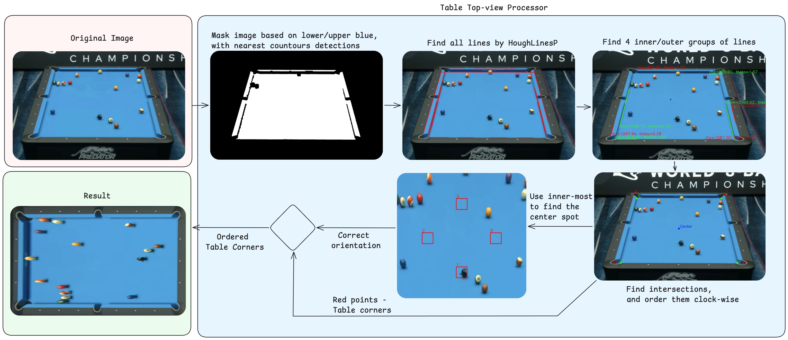
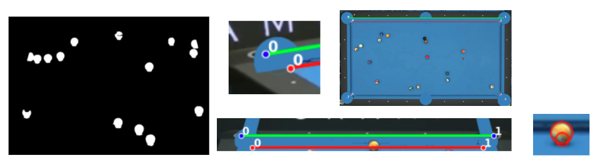

# Pool Ball Detection — Classical Computer Vision

The system analyzes images of 8-ball pool tables to count balls, locate them with bounding boxes, identify their numbers from color and stripe patterns, and reconstruct an oriented top view.

**[Read the report (PDF)](docs/1-report.pdf)** · [Project description](docs/1-project-description.pdf)

## Approach

1. **Find the table:** estimate the cloth color in HSV, clean the mask with morphological operations,
   and recover the inner and outer boundaries using Canny edges and the Hough line transform.
2. **Rectify the perspective:** intersect the boundaries, apply a perspective transform, and use
   the table spot to orient the top view, with a geometric fallback.
3. **Detect balls:** suppress cushion shadows and pockets, segment the foreground, detect Hough
   circles, and filter overlapping detections.
4. **Identify numbers:** distinguish cue, black, solid, and striped balls using pixel colors,
   then assign reference colors with the Hungarian algorithm.

<p align="center">
  
</p>

<p align="center">
  
</p>

## Run Part 1

From the repository root, create an environment and install the classical pipeline's dependencies
(versions listed in the source):

```bash
python3 -m venv .venv
source .venv/bin/activate
python -m pip install numpy==2.4.3 opencv-python==4.13.0.92 scipy==1.17.1

python src/task1.py \
  --input_json data/json/input.json \
  --data-dir data \
  --output-json data/outputs/detections.json \
  --topdown-dir data/outputs/topdown
```

The supplied input lists the **50 development images** included in the repository. To use other
images, update its `image_path` list; each path is relative to `--data-dir`.
Add `--n_jobs -1` to process images using all available CPU cores.

The command writes top-view images to `data/outputs/topdown/` and a JSON list to
`data/outputs/detections.json`. Each result contains `image_path`, `num_balls`, and `balls`, with `number` and normalized `[0, 1]` coordinates (`xmin`, `xmax`, `ymin`, `ymax`) for each ball.
The cue ball is `0`; an unassigned number is `-1`.
See the [example output](data/json/output_example.json) for the full format.

## Repository

| Path | Contents |
| --- | --- |
| [`src/task1.py`](src/task1.py) | Classical detection and table rectification pipeline |
| [`notebooks/`](notebooks/) | Image exploration, top-view, and ball detection experiments |
| [`data/development_set/`](data/development_set/) | Part 1 development images |
| [`docs/report/`](docs/report/) | LaTeX report source and figures |

`src/task2.py` and `run.sh` contain the separate CNN ball-counting work. The full
`requirements.txt` also includes dependencies for that task and the notebooks.

